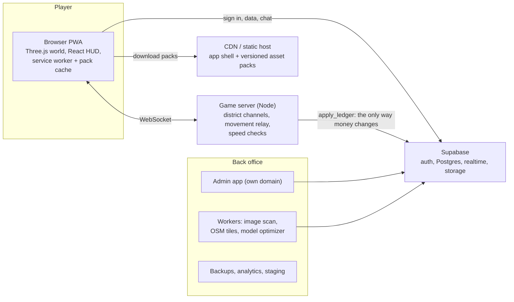

# Architecture

## Rules the code follows

- **The server decides money.** Browsers can read their wallet, ledger and inventory but cannot write them. Only `apply_ledger` (callable by `service_role` alone) changes a balance, and every change is one append-only ledger row. A repeated `ref` is applied once, so retries are safe. See `supabase/migrations/` and its tests.
- **Movement is trusted but speed-checked.** The client moves itself. The game server rejects moves faster than the limit for the player's mode and tells the client to snap back (`packages/shared/src/movement.ts`).
- **The server decides what you may hear and see.** A player is only told about others within 90 m, chat reaches 80 m, and a blocked player is hidden both ways. Chat is checked on the server (word filter, links and contact details, rate limit, mute), never in the browser. Sign-in uses the Supabase access token, checked with Supabase on join; money still changes only through `apply_ledger`.
- **Channels cap crowds.** Each district runs channels of up to 100 players; a joining player goes to the lowest channel with room (`apps/server/src/channels.ts`).
- **First load is small; the rest is optional.** The app shell is precached. Model packs are separate, versioned, hash-checked, cached on the device, and fetched from the Downloads page. An update fetches only the files that changed (`apps/client/src/packs/`).
- **Updates never reload a live session unasked.** A new version waits behind an animated "what's new" card until the player taps Update.
- **Hosts are configuration.** See `HOSTING.md`.

## Packages

| Path                   | Purpose                                                           |
| ---------------------- | ----------------------------------------------------------------- |
| `apps/client`          | Game: Vite, React, Three.js, PWA                                  |
| `apps/server`          | Live game server: Node, WebSocket                                 |
| `apps/admin`           | Admin app (placeholder until Phase 2)                             |
| `packages/shared`      | Types, constants, movement rules, design tokens                   |
| `packages/asset-tools` | Licence check, model optimizer, pack builder                      |
| `supabase/`            | Migrations and database tests                                     |
| `assets-src/`          | Licence manifest and pack definitions; raw models stay out of git |

## How multiplayer works

- `packages/shared/src/protocol.ts` is the one description of every message. Client and server both import it, so a change that breaks one fails the build of the other.
- **Server** (`apps/server/src`): `game.ts` holds the rules (join, move, chat, block, report) and is tested without sockets by feeding it messages; `server.ts` is the thin WebSocket layer around it; `moderation.ts` is the chat guard; `store.ts` saves to Supabase over its REST interface with the secret key (or to memory when it is not configured); `auth.ts` checks sign-in.
- **Client** (`apps/client/src`): `net/client.ts` keeps the connection alive and sends the player's position about 10 times a second, only when it changed; `net/room.ts` and `net/useMultiplayer.ts` turn server messages into interface state and world calls; `game/remote.ts` draws other players (capsule first, real avatar when built), `game/labels.ts` draws name tags and bubbles as page elements.
- **Peers have a session id, not an account id.** Chat, block and report refer to that id; the server maps it to the account, so the browser never learns anyone's account id.

## How life works

- **Rules are shared, state is the server's.** `packages/shared/src/life` holds the rules as plain functions and data: how fast needs fall, what a job pays, what a meal costs, what furniture exists and where it may stand. The browser uses them to show choices and disable buttons; the server uses the same code to decide, so they cannot drift apart.
- **The server decides, the browser asks.** Requests are small messages (`order`, `work`, `buy`, `place`...). The server checks where the player is (against the same city layout the browser draws), what they have and what the rules allow, then answers with the new `life` snapshot or a notice. Prices, wages and positions sent by the browser are never used.
- **Money is a ledger.** `apps/server/src/life.ts` never edits a balance. It calls the store, which calls the database's `apply_ledger` (wages, meals, bills) or `purchase_item` (charge and deliver in one transaction). Every call carries a fixed reference, so a retry is safe, and when the database fails the player is told and nothing changes.
- **Time only runs while you are here.** Needs, shifts and bills advance in one-second steps for connected players. Away means standing still, so nobody returns to a lost home.
- **Homes are instanced and arranged on a grid.** Indoors a player is hidden from the city and the browser draws their own room (`apps/client/src/game/interior.ts`) from the layout the server holds. Placing, moving and storing furniture are requests; the server re-checks ownership and fit with the same `canPlace` the browser used to colour the ghost.
- **One store interface, two backends.** `LifeStore` has a Supabase implementation (REST, secret key) and a memory one with identical rules, used by tests and by local play. Development guests (ids that are not real accounts) live in memory even when Supabase is configured.

## How the world is drawn

- **Layout is data.** `apps/client/src/game/district/layout.ts` builds streets, blocks, buildings, furniture, colliders and places from a seed. The same layout drives the default look, the model look, collisions, the minimap and the map.
- **Two looks, one world.** Every block starts as one merged low-detail mesh. When the city pack is downloaded, blocks near the player are drawn from the real models instead, built as instanced meshes with each model's untextured parts baked into one geometry. A block switches by its distance to the player, with a small margin so it does not flicker.
- **Avatars are one draw call.** Parts from different outfits are bound to the shared skeleton and merged, with colours baked in per vertex so skin and hair tints cost nothing extra.
- **Budgets.** `pnpm perf` checks draw calls and triangles at four worst-case spots on both quality tiers.
- **Dev pages.** `/#lab` shows twenty mixed avatars; `/#gallery` shows every city model with its axes. URL options in dev: `?t=21:30` freezes the time, `?autodl` downloads every pack, `?debug` shows fps, draw calls and triangles.
