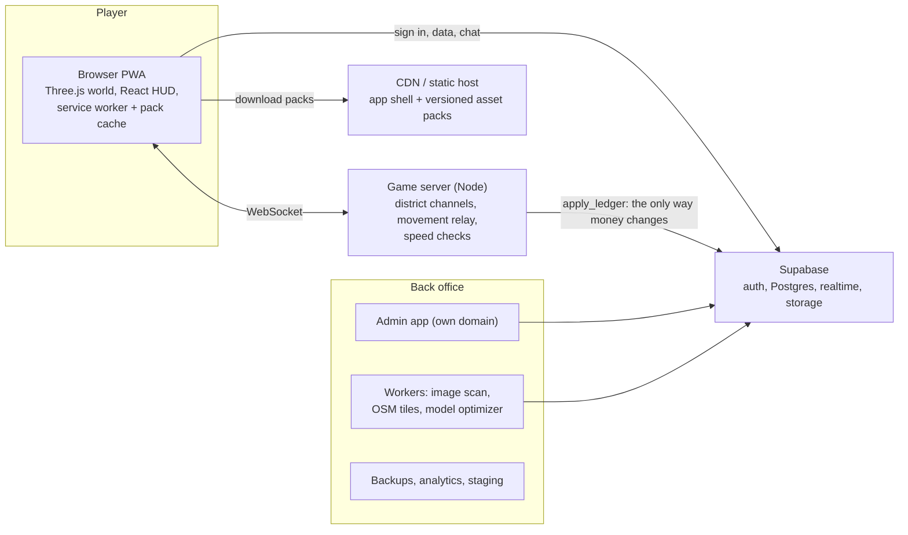

# Architecture

## Rules the code follows

- **The server decides money.** Browsers can read their wallet, ledger and inventory but cannot write them. Only `apply_ledger` (callable by `service_role` alone) changes a balance, and every change is one append-only ledger row. A repeated `ref` is applied once, so retries are safe. See `supabase/migrations/` and its tests.
- **Movement is trusted but speed-checked.** The client moves itself. The game server rejects moves faster than the limit for the player's mode and tells the client to snap back (`packages/shared/src/movement.ts`).
- **Channels cap crowds.** Each district runs channels of up to 100 players; a joining player goes to the lowest channel with room (`apps/server/src/channels.ts`).
- **First load is small; the rest is optional.** The app shell is precached. Model packs are separate, versioned, hash-checked, cached on the device, and fetched from the Downloads page. An update fetches only the files that changed (`apps/client/src/packs/`).
- **Updates never reload a live session unasked.** A new version waits behind an animated "what's new" card until the player taps Update.
- **Hosts are configuration.** See `HOSTING.md`.

## Packages

| Path                   | Purpose                                                           |
| ---------------------- | ----------------------------------------------------------------- |
| `apps/client`          | Game: Vite, React, Three.js, PWA                                  |
| `apps/server`          | Live game server: Node, WebSocket                                 |
| `apps/admin`           | Admin app (placeholder until Phase 2)                             |
| `packages/shared`      | Types, constants, movement rules, design tokens                   |
| `packages/asset-tools` | Licence check, model optimizer, pack builder                      |
| `supabase/`            | Migrations and database tests                                     |
| `assets-src/`          | Licence manifest and pack definitions; raw models stay out of git |
